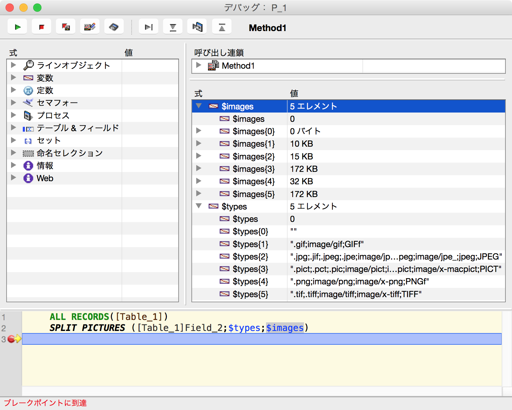

[](LICENSE)


# 4d-plugin-split-pictures
Split a composite 4D picture (field or variable) into an array of native formats. 

## Syntax

```4d
SPLIT PICTURES (picture;types;images)
```

Parameter|Type|Description
------------|------------|----
picture|PICTURE|
types|ARRAY TEXT|
images|ARRAY PICTURE|

## Examples

```
ALL RECORDS([Table_1])
SPLIT PICTURES ([Table_1]Field_2;$types;$images)
```



## Native ownership checks

Run `python3 -B .github/tests/test_ownership.py -v` on macOS for unsigned,
offline ASan/UBSan checks of the complete bundled SDK, all 16 wrappers and
the actual dispatcher. No native image/file commands or project build phases
are executed. See the [audit and limitations](.github/tests/ownership-audit.md)
for exact contracts, baseline failures and deferred metadata/OOM behavior.

## Manual source versioning and publication

Run **Bump version** on an explicitly selected branch with `patch`, `minor` or
`major`. It validates the immutable selected commit and clean checkout, then
commits only source metadata to that branch. It creates no tag and triggers no
Build. An executable advertised-SHA pre-push guard requires exactly one update,
the exact selected old SHA and a clean, single-parent direct child as the new
HEAD. Branch advances, rewinds, deletion and same-result races fail closed.
Push is non-force with follow-tags disabled.

Run **Build** separately on the desired commit using the Actions branch selector.
It has zero inputs, checks out `github.sha` in every job and derives `vX.Y.Z`
and asset names from strict source metadata, not tags. There is no default-branch
restriction. Publication is serialized across branches without cancellation.

The original Bump header requires coordinated marketing/current versions; its
marketing-first implementation incorrectly left current and localized values
behind. This migration repairs the six `CURRENT_PROJECT_VERSION` literals and
English display/info strings from `2.0.0` to the existing `2.0.5`, with no release
increment. Future bumps validate and co-bump applicable literals in
`Split Pictures.xcodeproj/project.pbxproj`, `Info.plist` and
`English.lproj/InfoPlist.strings`. Supported Xcode references remain references,
and absent `CFBundleVersion` stays absent. BOM, CR-only/CRLF/mixed line endings,
permissions, copyright and unrelated bytes are preserved. Prebuilt bundles,
dependencies, 4D data/schema, manifests and localization counters are excluded.

Build retains Windows x64 MSBuild with v143/Windows SDK 10.0 overrides, artifact
upload/download and bundle merge, followed by universal macOS Xcode using the
existing Cocoa, AppKit and CoreGraphics frameworks and resource phases (including
`constants.xlf`). Fresh binary architecture checks, Developer ID signing and
verification, ZIP/DMG packaging, both notarization submissions and DMG stapling
remain publication gates. Notarization must explicitly report `Accepted`.
The original static `test/Plugins` build layout and output normalization remain
unchanged; native runner/toolchain/path compatibility still needs a separately
authorized native run. Python tests do not execute native or signing tools.

Signing secret names remain `APPLE_DEVELOPER_ID_CERTIFICATE`,
`APPLE_DEVELOPER_ID_CERTIFICATE_PASSWORD`, `KEYCHAIN_PASSWORD`,
`NOTARYTOOL_APPLE_ID`, `NOTARYTOOL_TEAM_ID` and `NOTARYTOOL_PASSWORD`.

### Create-only safety and recovery

Before native work and again after all native/sign/notary/staple gates, checks
require an absent remote tag and a complete authenticated, validated, paginated
release listing including drafts. Authentication, 404, network, malformed data
and later-page errors stop publication.

Publication POSTs a new tag ref at exactly the selected SHA and verifies its
remote SHA; even a concurrent same-SHA creation fails. It separately POSTs a new
public, non-prerelease release with explicit tag, target SHA, name and empty body
(the original notes policy). Assets are separately POSTed to the newly returned
release ID. There is no update, reuse, clobber, deletion, rollback or retry.

On failure, **any created tag, release and uploaded assets remain**. Inspect the
selected SHA, tag and release ID in logs and remote tags/releases. A rerun of the
same version deliberately fails on existing tags or draft/published releases.
Recovery requires a separate maintainer decision: retain the partial record or
investigate and explicitly authorize manual cleanup; use Bump for a new version
when a new publication is appropriate. A failed API response does not prove
that no remote object was created.

Local checks (no native/signing execution):
`python3 -B -m unittest discover -s .github/tests` and
`actionlint .github/workflows/*.yml`.
